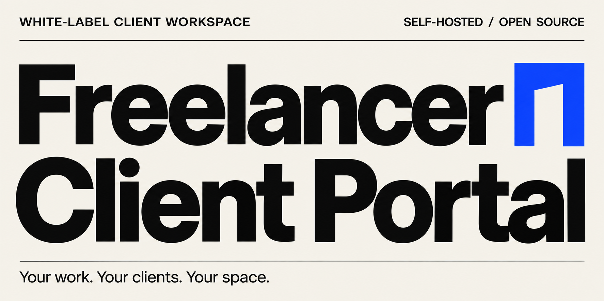
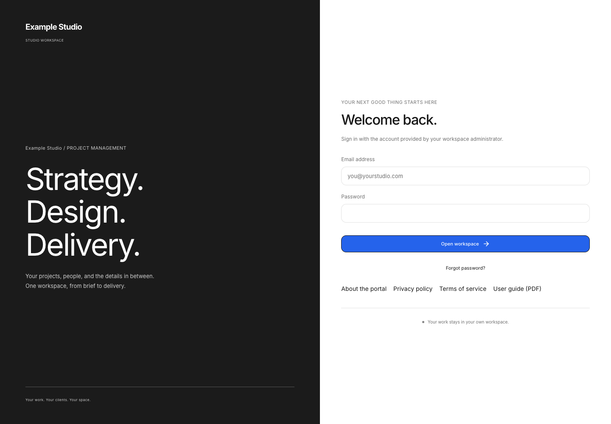

<p align="center">
  
</p>

# Freelancer Client Portal

A self-hosted, white-label workspace for freelancers and their clients. Manage projects, share files, collect feedback, prepare documents, and track time and billing under your own name.

Built with Next.js, React, TypeScript, and Supabase. This is a full application with a database and authentication, not a static GitHub Pages site.

[**Open the live demo →**](https://freelancer-client-portal-demo.netlify.app)

Explore the freelancer workspace and client view without creating an account. The demo uses fictional data; edits stay in your browser tab and reset on reload. Sending email, collecting payments, uploads, and external integrations require your own installation. [About the demo](docs/DEMO.md).

[Download the installation and user guide](docs/Freelancer-Client-Portal-Guide.pdf) · [Read the guide online](docs/USER-GUIDE.md) · [Customize your brand](docs/BRANDING.md)



## Make it yours

Use **Use this template** on GitHub to create your own repository. The MIT license permits personal and commercial use, modification, and redistribution. Keep the license notice in your source distribution. No visible attribution badge is required in your portal.

Edit `config/brand.json` to set your studio name, owner, support email, website, portal URL, logo, favicon, and accent colors. Those settings feed the interface, document identity, PDFs, and invitation copy. Each deployed installation has one public brand; workspace names and members are managed inside the app.

## Run locally

Install Node.js 24 and Docker with Compose. Allow roughly 8 GB RAM for the bundled Supabase stack. Run commands from the repository folder.

```sh
npm ci
npm run setup
docker compose up -d --wait --wait-timeout 240
sh scripts/migrate.sh
```

The setup command generates random local secrets in ignored `.env` and `.env.local` files. Do not copy `.env.example` over those generated files. It is a reference for optional settings.

For a demonstration with fictional projects:

```sh
node --env-file=.env scripts/seed.mjs
npm run dev
```

After the setup commands finish and the development server is running, enter `http://127.0.0.1:3100` in your browser. This address opens your own computer; it is separate from the public demo above. Local demo passwords are `Studio-demo-2026!`.

| Email | Role |
| --- | --- |
| `admin@studio.test` | Administrator in both demo workspaces |
| `mia@studio.test` | Regular user |
| `jules@studio.test` | Regular user |
| `contractor@studio.test` | Contractor with project restrictions |
| `client@northstar.test` | Client in Northstar Studio |

For your own empty workspace, skip the seed. Add `ADMIN_EMAIL`, `ADMIN_NAME`, and `ADMIN_WORKSPACE` to the private `.env`, then run:

```sh
npm run setup:admin
npm run dev
```

The first-admin command generates and displays an initial password once, unless you supply `ADMIN_PASSWORD` with at least 16 characters. Save it privately. Remove the `ADMIN_*` values after setup. The command refuses to run once an administrator exists. Invite later accounts through Workspace settings.

## Included

- Freelancer dashboard, projects, tasks, dependencies, calendars, scheduling, and reusable blueprints.
- Client home, shared project content, messages, file delivery, reviews, approvals, and service requests.
- Documents and payments, PDF exports, billing profiles and records, recurring invoice drafts, budgets, retainers, time tracking, and studio expenses.
- Workspace roles, explicit project invitations, per-tool client visibility, profile settings, password recovery, and authenticator-based MFA.
- Optional Google email, Dropbox/S3 storage, payment providers, AI drafting, and website monitoring. Each requires your own configuration and credentials.

A client must be invited to a project, the relevant tool must be enabled, and individual content must be shared. Read [the guide](docs/USER-GUIDE.md) before inviting real clients.

## Deploy

Use a Node-compatible host and your own Supabase instance. `netlify.toml` and a Dockerfile are included. GitHub Pages cannot run this app. Hosting the repository does not deploy a working portal.

Follow the guide's hosted deployment chapter: apply all migrations, set server-only credentials, configure public URLs and Auth redirects, create the first administrator, and verify two separate test client accounts. Replace the privacy and terms placeholder pages before collecting real client data. Document and service templates also need your review.

## Development and checks

```sh
npm run typecheck
npm run test:template
node --import tsx scripts/check-client-portal.tsx
npm run test:documents
npm run build
```

`npm test` needs a running, migrated, seeded local backend and Chrome. It writes test records to the demo workspace. Never point it at a live client database. The integration workflow is available separately from the fast build checks.

See [VERIFICATION.md](docs/VERIFICATION.md) for the checks actually run for this release and their limits.

## License and contributions

Application code and original geometric icons: MIT. Bundled Work Sans fonts retain their SIL Open Font License. Supabase configuration retains its upstream license. Dependencies keep their own licenses; see [THIRD-PARTY-NOTICES.md](THIRD-PARTY-NOTICES.md).

Report reproducible bugs through Issues. Do not include credentials, client records, or database exports. See [CONTRIBUTING.md](CONTRIBUTING.md) and [SECURITY.md](SECURITY.md).
